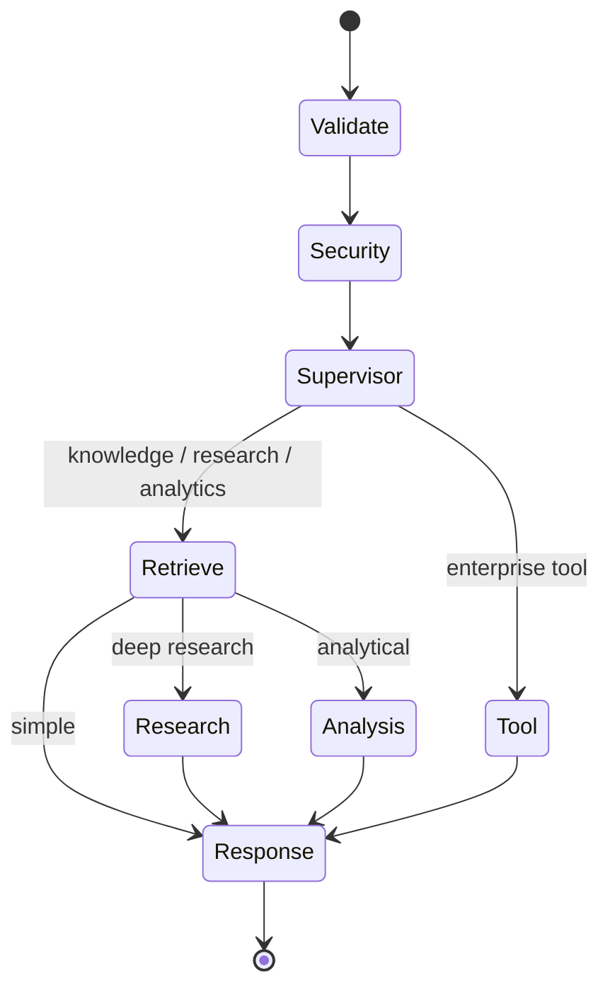

# Architecture

## Design goals
The platform separates policy enforcement from probabilistic model behavior. FastAPI owns authentication, validation and rate limiting. LangGraph makes routing and specialist execution explicit. Retrieval returns structured evidence; response generation may only use validated evidence IDs.

## LangGraph state
`AgentState` carries identity context, query, intent, plan, evidence, citations, tool calls, validation results, memory context, recursion depth, errors, activity events, analysis/tool output and final answer. This creates a traceable contract between nodes and keeps control-plane information explicit.

## Failure isolation
Validation and authorization failures are not retried. External/transient dependencies can be wrapped with bounded retries. Optional reranking is expected to fail open to the original hybrid ordering. Specialist failures should be recorded in state so a later response can degrade with a transparent limitation rather than corrupt the full conversation.
